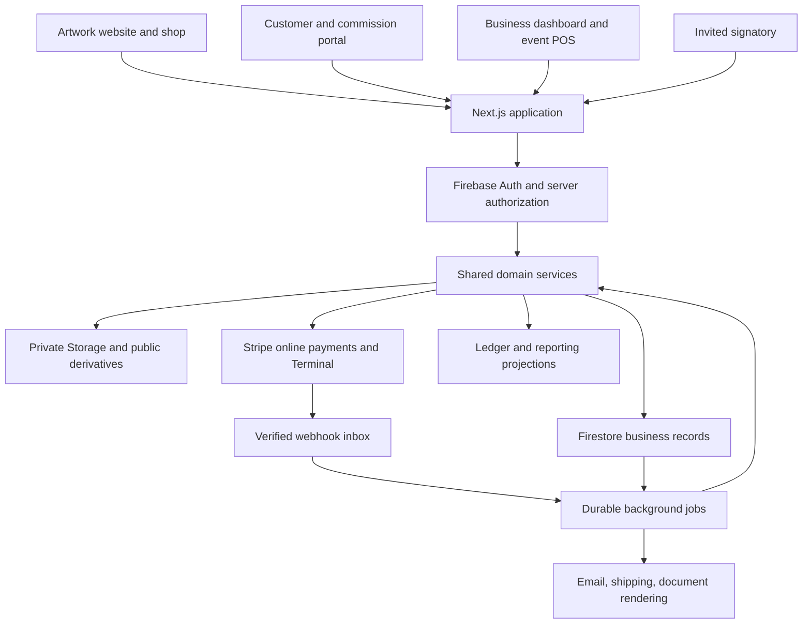

# Architecture

## Application shape

Use one modular Next.js application and one authoritative business data store. The public website, retail account area, commission portal, admin dashboard, signing flow, and event POS share domain services. They have separate layouts and authorization policies.

This retains the useful stack from both sources while preventing divergent stock, customer, invoice, or payment records. A modular application is appropriate for two primary operators; independent services and a multi-artist SaaS control panel would add operational work without a current business requirement.



The diagram represents logical boundaries. Public visitors do not gain dashboard access by sharing the same deployment.

## Stack baseline

Official documentation was checked on September 15, 2026. These are planning baselines; resolve and pin compatible stable patch versions when creating the app, then record them in its lockfile. For the actual installed versions and compatibility decisions, see [implementation status](07-implementation-status.md).

| Layer | Recommendation and evidence |
| --- | --- |
| Runtime | Node.js 24 LTS, latest supported patch. The official release table lists 24 as LTS and 26 as Current at review time. [Node release schedule](https://nodejs.org/en/about/previous-releases) |
| Framework | Next.js App Router, current stable 16.x; official installation docs displayed 16.3.5. Align `eslint-config-next` and framework versions. [Next installation](https://nextjs.org/docs/app/getting-started/installation) |
| UI runtime | React/React DOM current compatible stable versions; official React docs list 19.3. Confirm Next.js peer compatibility before pinning. [React versions](https://react.dev/versions) |
| Language | Current stable TypeScript supported by the selected framework, strict checks, runtime Zod validation at boundaries. Do not assume the source projects' `^5` range remains the right pin. [TypeScript installation](https://www.typescriptlang.org/download/) |
| Styling | Tailwind CSS 4.x with a small token system; docs displayed 4.3. Reuse suitable source UI primitives. Avoid carrying two complete component systems; retain MUI only if a specific complex control justifies it after review. [Tailwind documentation](https://tailwindcss.com/docs/installation/using-vite) |
| Forms/state | React Hook Form and Zod, using compatible stable releases. Keep server data authoritative; Zustand only for transient cart/UI state. Revalidate persisted carts at checkout. |
| Identity/data/files | Firebase Auth, Firestore, Cloud Storage, Admin SDK; current supported stable releases pinned at setup. Use emulators locally. [Firebase JS releases](https://firebase.google.com/support/release-notes/js) |
| Payments | Stripe server SDK, supported web UI SDK, Payment Element for online checkout; Terminal server-driven integration for compatible event readers. Pin/test the Stripe API version as well as SDK versions. [Stripe Terminal setup](https://docs.stripe.com/terminal/payments/setup-integration?terminal-sdk-platform=server-driven) |
| Web hosting | Vercel as a proposed Next.js host, subject to budget/region configuration. Keep provider credentials and environment bindings separate for development, staging, production. |
| Background work | Firebase/Google Cloud managed tasks and scheduler, executing shared domain handlers in workers. Firestore outbox/inbox records provide durable intent and recovery. Confirm runtime support separately from web runtime when provisioning. |
| Email/shipping | Provider adapters; select services after domain, volume, countries, and budget are known. Support recorded tracking numbers independent of label purchase integration. |
| Validation | TypeScript, ESLint, focused domain tests, Firebase rules/emulator integration tests, browser workflow tests, and Stripe sandbox/simulated-reader tests. |

## Code organization

Target structure. The application and core now exist; workers and Firebase infrastructure are still planned. See [implementation status](07-implementation-status.md).

```text
sadboi-platform/
  docs/
  web-app/
    src/app/
      (public)/                 # /, /art, /shop, /collaborations, /appearances
      (account)/account/        # customer and commission access
      (admin)/admin/            # business operations and /admin/pos
      (sign)/sign/              # invite exchange and scoped signing session
      api/                     # verified routes and webhooks
    src/components/            # shared primitives and domain views
    src/server/                # sessions, permissions, provider initialization
    public/                    # branding and explicitly public assets
  core/
    domains/                   # catalog, inventory, orders, commissions,
                               # licensing, events, finance, publishing
    contracts/                 # validation schemas, DTOs, provider interfaces
    infrastructure/            # Firestore repositories and provider adapters
  workers/                     # shared-core job handlers and schedules
  firebase/                    # rules, indexes, emulator configuration
  scripts/                     # seed, import/export, recovery utilities
```

A small workspace can share `core` between web and workers without creating multiple repositories. Domain code should not import UI components or depend on browser Firebase types. Repository/adaptor boundaries permit a future datastore change without rewriting business rules.

## Data persistence decision

Retain Firestore for the first installation because both source projects use it and it supports the necessary small transactional units. Store operational records, append-only stock movements, and balanced journal entries, with query-specific reporting projections. Never derive financial truth from a sum of mutable dashboard cards.

Firestore requires deliberate indexes, denormalized read models, integrity checks in services, and bounded transactions. Prototype simultaneous checkout, ledger posting, and reconciliation early. If those tests reveal unacceptable complexity or reporting cost, switch the operational store to PostgreSQL before migrating real data; retain Firebase Auth/Storage if useful. PostgreSQL is a contingency, not a second authoritative stock/payment store.

Use `businesses/{businessId}/...` for private records and server-managed memberships. Derive `businessId` from verified session/context, not a caller's unchecked parameter. Keep public catalog projections in a separate published namespace that contains no costs, private notes, identity records, master files, or agreements. Every lookup across IDs must verify the same business and applicable ownership.

## Authorization and files

Firebase Auth establishes identity; server-side membership checks determine permissions. Use secure HTTP-only sessions with expiration, revocation handling, CSRF protection for mutations, and reauthentication for sensitive account changes. Firebase documents the session-cookie pattern in its [Admin session guidance](https://firebase.google.com/docs/auth/admin/manage-cookies).

Two named users receive super-admin memberships through a controlled bootstrap. Legal and accounting access is explicitly invited. Customers can edit allowed profile fields only. Users cannot write membership, role, payment status, stock, signing evidence, ledger, or audit records directly. Admin SDK bypasses Firestore rules, so every server handler must enforce authorization itself. Rules provide defense in depth for any allowed client operations.

Store public image derivatives separately from private master art, print files, agreement snapshots, proofs, receipts, and deliveries. Use authorized short-lived access for private files and private/cache-safe responses. Validate file type/size, quarantine untrusted uploads, and create optimized previews in background jobs. File records contain content hashes, version IDs, and access classification; a public preview never implies permission to download its master.

Do not include analytics/session replay on signing or private financial/client pages. Redact invite secrets, access URLs, personal data, and payment details from routine logs. Use fresh accounts/project IDs and narrowly scoped service credentials.

## Inventory and checkout consistency

The inventory service owns all stock mutation. For each variant/location, maintain physical `onHand`, temporary `reserved`, paid-but-unfulfilled `allocated`, and `unavailable` (damaged/quarantined) quantities. Available stock is `onHand - reserved - allocated - unavailable`. Each unit belongs to exactly one of those availability categories. Online availability includes only locations approved for online fulfillment.

1. Server validates SKU, quantity, active publication, delivery method, destination, discounts, currency, and current prices; save an expiring quote snapshot.
2. In a transaction, validate availability, reserve stock, create a pending order, and record a payment attempt with a stable idempotency key.
3. Call Stripe outside the transaction. Persist provider IDs. A retry finds the same attempt; an interrupted call is reconciled before another charge is allowed.
4. Verify and durably record webhook receipts. A worker checks business, provider object, expected order/attempt, amount, currency, and payment state.
5. Transactionally apply each business effect once: settle payment, convert reservation to allocation, create postings/history, and enqueue receipt/fulfillment work.
6. On actual dispatch or in-person handoff, reduce physical stock and its allocation. Do not decrement the same stock a second time on duplicate webhooks or repeated fulfillment clicks.
7. Expiration/cancellation releases stock only after checking the payment attempt. A late successful payment must reacquire stock transactionally or enter a visible paid-but-unfulfillable/refund resolution state. Never silently promise unavailable goods.

Made-to-order and preorder variants reserve explicit production/edition capacity rather than pretending future items are physical stock. Publish lead times and acceptance limits. Refund completion and restocking are separate events; a damaged or unreturned item does not become sellable because its payment was refunded.

Firestore transactions can rerun their function, so do not call Stripe, send emails, or buy shipping labels inside them. [Firestore transaction behavior](https://firebase.google.com/docs/firestore/manage-data/transactions)

## Payments and event POS

Use one payment domain for retail, POS, commission installments, and license invoices, with a typed purpose and immutable references. Keep payments, allocations to debts, processor fees, refunds, disputes, and payouts distinct. A payout is a transfer of funds, not another sale.

The proposed browser POS selects event/location, creates the cart/order through the same pricing/stock services, and instructs a compatible internet-connected Stripe smart reader through the server. Reader action success is not itself proof of settled payment. Verify provider payment state before handoff. Lock reader use per attempt and reconcile cancellation/timeouts before starting replacements.

Stripe's server-driven integration supports compatible smart readers and does not support offline card collection. Design this POS as online-required, with connectivity checks and explicit pending/error states. QR checkout can send patrons to a scoped online checkout for that order; it is an online payment path, not card-present processing. Phone-only Tap to Pay requires a supported native SDK and device/region validation. [Server-driven capabilities](https://docs.stripe.com/terminal/payments/setup-integration?terminal-sdk-platform=server-driven), [Tap to Pay](https://docs.stripe.com/terminal/payments/setup-reader/tap-to-pay)

Cash and legacy Venmo records may be entered as separate tenders, with operator, event, amount, timestamp, reference, and reconciliation state. Do not label them as Stripe charges. When connectivity is unavailable, an unsynced note is not a confirmed platform sale or stock guarantee.

## Reliable jobs and webhooks

Store each verified Stripe event under its provider event ID before acknowledgement. If durable storage fails, return a retryable failure. Process with retryable workers; use operation-level uniqueness (payment ID, refund ID, stock movement source, posting source) as well as event-ID deduplication. Handle out-of-order events by valid state transitions and provider reconciliation, not timestamps alone. Stripe explicitly documents duplicate deliveries and asynchronous processing. [Webhook guidance](https://docs.stripe.com/webhooks)

An outbox entry is committed with the domain mutation. A worker dispatches email, document rendering, reminders, publishing projections, and shipping tasks with stable keys and retry limits. A scheduled recovery job finds undispatched work and stale payment attempts. Failed jobs appear in the dashboard with safe retry controls. Notifications can fail without losing the underlying payment, signature, or order.

## Reporting and operations

Use immutable source-linked journal entries and stock movements; materialize daily summaries by channel, event, product, commission, and license. Paginate operational tables. Track projection freshness and offer a rebuild path. Separate booked revenue, cash received, receivables, sales tax, gross margin, operating expenses, and payouts.

Create development/staging/production isolation, runtime schema validation, structured error monitoring, payment/job alerts, backup schedules, and restore rehearsal. Data exports include stable IDs, relationships, files manifest, currency, timestamps, and provenance. Configure retention/anonymization without deleting legally required financial or executed-agreement evidence. Review recurring service usage and costs before provisioning and as volume grows.

## Future artist template

Put business name, branding, currency/timezone, numbering, products, legal templates, compensation, and providers in configuration. Avoid hardcoded Joel IDs in domain services. Export a clean seed without customer data or secrets. A future artist can use a separate deployment/database first; do not build onboarding, subscriptions, cross-artist administration, or Stripe Connect until a multi-business product is actually requested.
