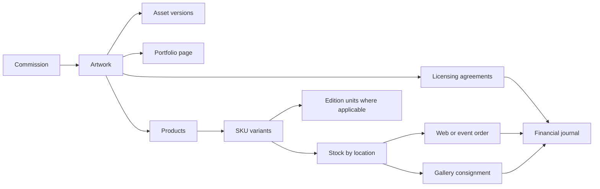

# Data model and workflows

## Record conventions

Every private record belongs to one business. Use stable internal IDs, schema versions, UTC server timestamps, creator/updater identity, and an explicit visibility classification. Store local event dates with a timezone; keep declared signing dates separate from system timestamps. Money uses integer minor units plus currency; use decimal-safe rates and explicit rounding rules for royalties and tax. Do not add unlike currencies together.

Historical order lines, invoices, agreements, royalty policies, and cost allocations keep snapshots. Renaming an artwork or changing a price must not rewrite issued documents. Archive referenced master records rather than breaking history. An append-only audit event records actor, action, target, request ID, timestamp, and relevant changes; it is distinct from ordinary project activity.

## Main entities

| Domain / entities | Required fields and relationships |
| --- | --- |
| Business, membership, settings | Legal/display names, timezone, currency, numbering, contact details, membership role/capabilities, status, expiry, and provider references. |
| Contact, organization, relationship | Names, verified contact methods, addresses, roles, communication/consent preferences, notes, follow-up owner, and linked documents. One person can have several business relationships. |
| Artwork | Title, slug, series, year, description/story, medium/software, tags, credits, copyright owner, public visibility, release date, source commission, linked licenses/appearances, and primary public image. |
| Asset, asset version | Artwork/project reference, master/proof/print/preview/deliverable category, storage key, checksum, format, pixel dimensions, physical dimensions/unit, DPI, color profile, revision, approval, access classification. |
| Print specification | Artwork version, print size, bleed/crop, paper/substrate, finish, color requirements, supplier instructions, approved proof, packaging, and effective version. |
| Edition, edition unit, certificate | Artwork/format, open or limited, edition cap, artist proofs policy, number, status, production batch, current location, order/owner, certificate ID and verification record. Enforce unique numbers and immutable cap changes/history. |
| Product, variant, collection | Public title/slug/story, linked artwork IDs, type, SKU, barcode, options, price/currency, cost reference, dimensions/weight, tax category, edition link, production policy, publication and collection order. |
| Supplier, quote, purchase order | Supplier contact, capabilities, line specifications, quantity, unit/landed costs, lead time, proof approval, payment terms, ordered/received quantities, attachments. |
| Production batch, receiving record | Supplier/PO, artwork/spec version, expected date, quantity, good/rejected/damaged counts, reprint reason, actual costs, receiving location, inspector. |
| Location, stock balance, movement | Storage/event/gallery/transit type, online fulfillment eligibility; variant/location counts; movement reason, quantity, source record, batch/cost layer, actor. |
| Reservation, allocation, transfer | Variant/location quantities, checkout/payment attempt, expiration and release reason, paid allocation, source/destination, dispatch/receipt state. |
| Order, order line, fulfillment | Channel, event, customer/guest contact, immutable item/price/tax/shipping snapshots, payment and fulfillment states, allocation IDs, packages, carrier/tracking, handoff evidence. |
| Return, exchange, refund, dispute | Original line/payment, quantity, requested/approved amount, condition, restock decision, provider state/ID, reason, evidence, replacement links. |
| Payment attempt, payment, allocation, payout | Purpose, expected amount/currency, idempotency key, provider IDs, settled amounts, invoice/order allocation, actual fee, refund/dispute relationship, payout reconciliation. |
| Project, commission, milestone | Contact, brief, artwork, budget, optional due dates, scope, deliverables, revision policy, assigned owner, tasks/time, proposal/agreement, payment schedule and status. |
| Review request, approval, change order | Exact asset version, client identity, requested action, comments/annotations, decision timestamp, included revision count, scope/price changes and acceptance. |
| Proposal, invoice, credit note | Unique number, client snapshot, line items, totals/currency, tax policy snapshot, issue/due dates, status, source project/license/event, installment, payment allocations, original-document references. |
| Agreement template/version, agreement/version | Type, merge fields, terms, parties/capacity, exact rendered content, attachment manifest, digest, review state, effective dates, required signers, amendment lineage. |
| Signing invitation/session/signature | Intended party/contact, immutable agreement version, token hash, expiry/revocation/use, verified session, full name, declared date, consent text/version, server signedAt, evidence, artifact reference. |
| License | Artwork/version, licensee, permitted media/products/uses, exclusivity, restrictions/approval rights, term, renewal/termination, publication permission, fixed/royalty/hybrid terms, agreement. No structured territory field. |
| Royalty policy, statement, statement line | Basis definition, rate/tiers, deductions/returns rules, reporting period/due date, advance recoupment/minimum guarantee treatment, units/base, source evidence, approval, calculated amount, invoice/payment allocation. |
| Event, appearance, booking | Type, organizer/venue, location/timezone, application/booking dates, fees, contract, public description, travel, tasks, stock location, sales channel, closeout. |
| Consignment, consignment line, settlement | Gallery/event, item/edition quantities sent/sold/returned/damaged, price and fee split snapshot, report, expected/actual remittance, settlement deadline and discrepancies. |
| Account, journal entry/line, expense, bill | Currency, posting date/period, balanced debits/credits, source ID, event/project/license/product dimensions, receipt, category, counterparty, due date, settlement/reversal and approval. |
| Compensation policy, accrual, payment | Manager/artist relationship, fee/share basis, deductions, effective dates, source earnings, earned/paid balances, supporting calculation and policy snapshot. |
| Content entry, collaboration, appearance page | Headline, body, artwork/assets, partner credit, outbound link, permitted publication, publish date, SEO and share metadata; commerce link optional. |
| Audit event, webhook receipt, outbox job | Business, source/object IDs, event/operation key, timestamps, durable state, retries, last safe error, actor and correlation ID. |

Public DTOs are explicit allowlists rather than raw database objects with a few fields removed.

## Artwork and product relationship

## Commission lifecycle

`inquiry -> qualified -> proposal -> agreement/deposit pending -> scheduled -> in progress -> client review -> final approval -> final balance -> delivered -> closed`

Allow explicitly recorded on-hold, declined, canceled, and disputed branches. Proposal acceptance and agreement signature are distinct actions. Templates configure whether a deposit/signature is required before work begins and whether final payment is required before master-file delivery.

Milestones each have deliverables, due dates, payment amounts, and approval state. Review comments attach to a specific asset version. An approval cannot silently transfer to a replacement version. Record included versus extra revisions; accepted change orders update scope and billing through versioned records. Client portal status exposes client-safe notes, not internal pricing, legal discussions, or work logs by default.

## Signing lifecycle

`draft -> internal review -> ready -> invited -> viewed -> partially signed -> executed`

Allow declined, expired, revoked, voided, and superseded states. A single required signer can proceed directly from viewed to executed; execution otherwise waits for every required signature, including artist countersignature if configured.

1. Merge an approved template with parties, artwork/use terms, compensation, and dates. Freeze canonical content and attachments under an agreement version and cryptographic digest.
2. Generate a cryptographically random, single-use invite code bound to one signer and version. Store a keyed hash, expiry, and revocation state. Avoid short guessable codes; rate-limit exchanges and omit secrets from logs/analytics.
3. Exchange the code for a short-lived signing session. Verify the intended contact, for example by a one-time email challenge, without requiring a full customer account. Opening a link does not consume the invitation; successful signature submission does.
4. Display the complete agreement, attachments, download option, and electronic-signing consent. Require full name, declared signing date, and an affirmative action to sign; capture signatory capacity if acting for a company.
5. The server validates session, signer, unexpired invite, document version/digest, and current agreement state. Transactionally record consent/signature evidence and consume the invitation. Concurrent submissions must produce one signature. A changed version invalidates outstanding invitations.
6. Record server UTC time separately from the entered date; preserve the entered date without representing it as proof of when the action occurred. Retain appropriate verification evidence and metadata under a documented privacy/retention policy.
7. Generate an executed copy and evidence certificate from the frozen version. Rendering/delivery is retryable without repeating the signature. Make the completed copy available to parties. Store artifact hashes and prevent normal application edits.
8. Amend through a new linked version and new signatures, keeping prior executed records intact.

This implements the requested typed-name signature experience with evidence of intent and association to the document. It does not assume a name and date alone guarantee enforceability. For U.S. transactions, E-SIGN addresses electronic validity and record retention, with additional consumer-consent requirements in applicable circumstances; governing jurisdiction and document-specific requirements still need legal review. [15 U.S.C. 7001](https://uscode.house.gov/view.xhtml?edition=prelim&req=granuleid%3AUSC-prelim-title15-section7001)

No signing invitations are sent during planning. An existing agreement can be uploaded as a historical executed document with its real signing provenance rather than fabricated platform signatures.

## License and royalty lifecycle

`lead -> negotiating -> agreement pending -> active -> renewal due -> renewed / expired / terminated`

Record fixed fees, royalty-only, or hybrid arrangements. Rights checks consider artwork, dates, permitted use/category, and exclusivity; flag potential overlap for review rather than silently resolving legal interpretation. Omit territory filtering/tracking as requested; preserve the complete original contract text even if it contains geographic wording.

Royalty statements progress `expected -> received -> validated -> approved -> invoiced -> partially paid / paid`. Store submitted statements and corrected versions. Every calculation identifies its approved policy version, reporting basis, exclusions, returns, tiers, advance recoupment, rounding, and currency. Prevent duplicate invoicing of a statement period/version. Renewal reminders do not automatically renew an agreement.

## Production, stock, and fulfillment

Production progresses `requested -> quoted -> ordered -> proof pending -> approved -> printing -> ready -> received -> closed`, with partial receipts and rejected/reprinted branches. Goods become sellable only after receiving/quality acceptance. Supplier invoices and production costs link to the same batch.

Transfers use `planned -> dispatched -> in transit -> received`, tracking partial receipt and discrepancy. Units in transit cannot be simultaneously available at both locations. Gallery consignment remains the business's tracked inventory until reported sold; sending it to a gallery is not a sale. Gallery locations are excluded from website availability unless explicit fulfillment arrangements support them.

Keep order/payment/fulfillment state independent:

| State family | Examples |
| --- | --- |
| Order | draft, awaiting payment, confirmed, canceled, closed |
| Payment | pending, processing, succeeded, failed, canceled, partially refunded, refunded; disputes tracked separately |
| Fulfillment | unallocated, allocated, awaiting production, picking, packed, partially shipped, shipped, collected, delivered, exception |
| Return | requested, authorized, received, inspected, restocked, replaced, closed |

Split packages and pickup at an event must not imply every line is fulfilled. A physical return's condition determines restocking. Edition replacements retain history of destroyed/lost originals and must follow the edition policy rather than silently minting duplicate numbers.

## Events, galleries, and settlements

Track `research -> application -> accepted/booked -> preparing -> active -> settling -> closed`, plus rejected/canceled. Link calendar, contract, booth fee, production plan, travel, stock packing list, and tasks. POS sales carry event and location IDs. Gallery reports identify sold units and agreed commission; settle only what was reported, with exceptions for missing stock or remittances.

Event profitability includes sales/license or appearance income attributed to the event, cost of goods sold, gallery/organizer fees, payment fees, booth/travel/shipping costs, and configured manager compensation. Distinguish profit from cash collected and receivables still due. Avoid counting both a POS sale and a later gallery/event settlement as new revenue for the same transaction.

## Finance rules

Build a balanced journal and supporting ledgers for receivables, payables, inventory, processor clearing, cash/bank, tax liability, royalties, compensation, and expenses. Every posted entry balances by currency and references the originating event. Correct posted records with reversals/adjustments; use period locks. Track manual bank/cash/Venmo entries and statement imports with deduplication/provenance since no accounting integration exists.

Accounting treatment is configurable and needs an accountant's review. The following examples explain system behavior, not a tax/accounting policy determination:

- A settled customer payment moves value into cash/processor clearing and allocates it to an invoice or a customer advance. Collecting it does not create a second copy of the underlying sale.
- A processor payout transfers clearing to bank, with actual fees/refunds/disputes reconciled separately.
- Production receipts establish inventory value under the selected costing policy; sale/fulfillment posts cost of goods sold according to the approved recognition policy.
- Collected sales tax is tracked separately from revenue; rates and treatment come from configured jurisdiction/category rules, not the old template's default.
- Gallery settlements clear receivables and recognize the agreed gallery deduction without duplicating reported sales.
- Management compensation accrues according to a versioned percentage/fixed-fee policy with an explicit basis; paying it settles an existing liability.

Reports include profit/loss, balance sheet and trial balance, cash movement, invoice aging, payables, inventory valuation, sales/tax summaries, royalty statements, management compensation, and product/event/commission/license profitability. Missing cost data produces a visible incomplete-margin indicator rather than an invented zero-cost profit.

## Required query/index plan

Define composite indexes alongside each implemented screen: orders by channel/event/state/date; invoices by contact/status/due date; stock by location/variant; movements by variant/date; commissions by owner/status/due date; licenses by status/expiry; statements by license/period; events by status/start date; journal lines by account/date and attribution; jobs by state/next attempt. Paginate and bound result sets. Use versioned materialized summaries for cross-domain reporting, with source IDs and rebuild/reconciliation tools.
